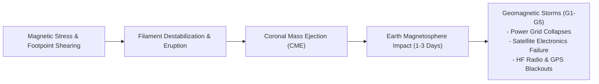

# Part 1: Problem Statement, Solar Physics Domain, Dataset Exploration & Evaluation Metrics

---

## 1. Problem Statement & Scientific Objective

### 1.1 Astrophysical Phenomenon: What are Solar Filaments?
Solar filaments are colossal, dense ribbons of relatively cool chromospheric plasma ($T \approx 6{,}000 - 10{,}000\text{ K}$) suspended high within the scorching solar corona ($T \approx 1{,}000{,}000 - 3{,}000{,}000\text{ K}$). 

Filaments do not float freely; they are held against gravity by helical magnetic field structures called **magnetic flux ropes** embedded along **Photospheric Neutral Lines (PNL)** or **Polarity Inversion Lines (PIL)**—the boundaries dividing regions of positive (outward-pointing) and negative (inward-pointing) vertical photospheric magnetic flux.

```
                  HOT CORONAL ENVIRONMENT (1,000,000 K)
                                    |
                            ~ ~ ~ ~ | ~ ~ ~ ~
                      ( Helical Magnetic Flux Rope )
                     /                              \
       [ COOL, DENSE PLASMA FORMATION: FILAMENT ]  <--- Strong absorption in H-alpha
      /                                                \
================================================================ Polarity Inversion Line (PIL)
       [ Positive (+) Magnetic Flux | Negative (-) Magnetic Flux ]
                        PHOTOSPHERE / CHROMOSPHERE
```

### 1.2 Spectral Signature: Why $H\alpha$ ($656.3\text{ nm}$)?
The hydrogen Balmer-alpha ($H\alpha$) spectral line at $\lambda = 656.28\text{ nm}$ corresponds to the atomic transition from the $n=3$ to $n=2$ energy level in neutral hydrogen.
- **On the Solar Disk (Filaments):** Because the filament plasma is significantly cooler and denser than the background chromosphere, it absorbs the underlying continuum radiation emitted by the solar disk. Consequently, filaments appear as dark, curvilinear, absorbing threads or ribbons against the brighter, granular chromospheric background.
- **Above the Solar Limb (Prominences):** When rotated to the solar limb (the edge of the visible disk) by solar rotation, these exact same physical formations project outward into the dark vacuum of space. Because there is no bright background disk behind them, their thermal emission at $656.3\text{ nm}$ causes them to appear as bright, glowing loops and plumes against space, historically named **solar prominences**.

> **Key Astrophysical Fact:** Filaments and prominences are identical physical entities viewed from different geometric vantage points. In this challenge, our target is the automated segmentation of filaments viewed in absorption against the full solar disk.

### 1.3 Space Weather Impact: Why Automated Segmentation Matters
Solar filaments are metastable structures. When the magnetic shear across the neutral line exceeds a critical threshold (via flux emergence, footpoint shearing, or magnetic reconnection), the flux rope destabilizes catastrophically in an eruptive phenomenon known as a **filament eruption**.



Filament eruptions are the primary physical triggers of **Coronal Mass Ejections (CMEs)**—eruptions that propel billions of tons of magnetized plasma into interplanetary space at velocities ranging from $300\text{ km/s}$ to over $3{,}000\text{ km/s}$.
When Earth-directed, CMEs collide with Earth's magnetosphere within 15 to 72 hours, generating geomagnetic storms:
1. **Power Grid Collapse:** Geomagnetically Induced Currents (GICs) saturate power transformers, leading to large-scale grid blackouts (e.g., the 1989 Quebec blackout).
2. **Satellite & Spacecraft Damage:** High-energy particle flux damages satellite electronics, degrades solar panels, and alters low-Earth orbit satellite drag.
3. **Communication & Navigation Disruption:** Severe ionospheric scintillation disables High-Frequency (HF) radio propagation and degrades GPS positioning accuracy from centimeters to tens of meters.

To provide automated space weather alerts, solar physics requires real-time monitoring of filament length, topological connectivity, curvature, and area across full-disk solar imagery. Manual tracing by human observers is subjective, labor-intensive, and impossible to scale to 24/7 continuous global monitoring.

---

## 2. Dataset Exploration: The MAGFiLO Benchmark

The dataset for this competition originates from the **MAGFiLO** benchmark (*Multi-Annotator Ground-truth of Filament Observations*, published in *Nature Scientific Data*, 2024; DOI: [10.1038/s41597-024-03876-y](https://doi.org/10.1038/s41597-024-03876-y)).

### 2.1 The Global Oscillation Network Group (GONG)
All observations are captured by the **Global Oscillation Network Group (GONG)**, a network of six identical ground-based solar telescopes operated by the National Solar Observatory (NSO) and strategically stationed worldwide to observe the Sun 24 hours a day without night-time interruption:

| Station ID | Observatory Name | Location | Elevation | Typical Optical / Atmospheric Seeing Characteristics |
| :---: | :--- | :--- | :---: | :--- |
| **Bh** | Big Bear Solar Observatory | California, USA | $2{,}055\text{ m}$ | High altitude, surrounded by lake water; good seeing with occasional thermal turbulence. |
| **Ch** | Cerro Tololo Inter-American Obs. | Chilean Andes | $2{,}200\text{ m}$ | Exceptionally dry; high transparency but exhibits systematic sensor gain attenuation (~15% contrast drop). |
| **Lh** | Learmonth Solar Observatory | Western Australia | $10\text{ m}$ | Coastal desert; high ambient heat causes thermal air currents and boundary seeing blur. |
| **Mh** | Mauna Loa Solar Observatory | Hawaii, USA | $3{,}440\text{ m}$ | Ultra-high volcanic altitude above the marine inversion layer; pristine contrast and minimal atmospheric blur. |
| **Th** | Teide Observatory | Canary Islands, Spain | $2{,}390\text{ m}$ | High mountain site above cloud level; superb optical contrast, sharp boundary gradients. |
| **Uh** | Udaipur Solar Observatory | Rajasthan, India | $595\text{ m}$ | Island site in Lake Pichola; water stabilizes ground turbulence, but tropical atmospheric haze can soften edges. |

### 2.2 Dataset Specifications & Format
- **Raw Spatial Dimensions:** Full-disk images are captured at $2048 \times 2048$ pixels resolution, single-channel (grayscale), stored as 8-bit or 16-bit uncompressed files.
- **Dataset Size:**
  - **Training Set:** 707 unique full-disk solar observation images with expert multi-annotator segmentations (1,154 annotation instances containing 8,199 matched filament instances).
  - **Test Set:** 180 unseen full-disk solar images evaluated on the competition server.
- **Annotation Schema:** Standard COCO JSON format (`MAGFiLO_1.0_Annotations_kaggle2026_train.json`), where individual filament instances are defined as polygons or Run-Length Encoded (RLE) bitmasks linked to specific image IDs.

---

## 3. Deep Learning & Computer Vision Challenges (First Principles)

Automated segmentation of solar filaments is substantially more difficult than standard biomedical or autonomous driving instance segmentation. An analysis of the data reveals five foundational deep learning challenges:

```
+----------------------------------------------------------------------------------------------------+
|                                    CHALLENGE TAXONOMY & DL FAILURE MODES                          |
+------------------------------+------------------------------------+--------------------------------+
| Physical Phenomenon          | Mathematical Manifestation         | Deep Learning Failure Mode     |
+------------------------------+------------------------------------+--------------------------------+
| 1. Curvilinear Anisotropy    | Length up to 1500px, width 3-15px; | Small convolutional kernels    |
|    (Extreme Aspect Ratios)   | aspect ratio AR > 20:1 to 100:1    | cause one-to-many fragmentation|
+------------------------------+------------------------------------+--------------------------------+
| 2. Extreme Class Imbalance   | Filament pixels < 0.8% of image;   | Naive random cropping causes   |
|    (Sparse Foreground)       | background quiet sun > 99.2%       | extreme gradient starvation    |
+------------------------------+------------------------------------+--------------------------------+
| 3. Multi-Station Domain      | 6 stations with varying sensor     | Fixed decision threshold fails;|
|    Shift (Photometric Blur)  | gain, PSF blur, and seeing contrast| faint filaments completely lost|
+------------------------------+------------------------------------+--------------------------------+
| 4. Epistemic Multi-Annotator | Average 1.63 annotators/image;     | Hard binary labels inject      |
|    Label Disagreement        | divergence on tapering barbs       | contradictory gradient noise   |
+------------------------------+------------------------------------+--------------------------------+
| 5. Solar Rotation Autocorr.  | 27-day synodic solar rotation;     | Random train/val split causes  |
|    (Temporal Data Leakage)   | flux ropes persist across days     | massive data leakage / overfit |
+------------------------------+------------------------------------+--------------------------------+
```

---

### 3.1 Challenge 1: Extreme Morphological Anisotropy & Receptive Field Saturation
- **The Physical Reality:** Magnetic flux ropes are geometrically confined along magnetic neutral lines. A quiescent filament can snake across hundreds of thousands of kilometers on the solar surface ($800\text{--}1500\text{ pixels}$ in a $2048 \times 2048$ image). Yet, perpendicularly, their physical cross-section is extremely narrow ($3\text{--}15\text{ pixels}$), tapering to 1–2 pixels at the extremities.
- **The Deep Learning Failure Mode:**
  Standard Convolutional Neural Networks (CNNs) rely on local $3 \times 3$ convolutional filters. The theoretical receptive field increases linearly with depth, but the **Effective Receptive Field (ERF)** (Luo et al., NeurIPS 2016) follows a Gaussian distribution with a standard deviation growing only as $O(\sqrt{L})$ where $L$ is depth:
  $$\text{ERF}_{\text{effective}} \ll \text{Receptive Field}_{\text{theoretical}}$$
  Because the ERF is localized, the network cannot propagate information from an active filament head to an undulating tail $500\text{ pixels}$ away across faint, discontinuous chromospheric absorption gaps. The network predicts disconnected fragments rather than a single continuous instance.
- **Solution Required:**
  1. Deep backbones equipped with large depthwise convolutions ($7 \times 7$ kernels in ConvNeXt).
  2. Spatial and Channel Squeeze-and-Excitation (`scSE`) attention modules to capture long-range contextual dependencies.
  3. Collinear Endpoint Gap Bridging (CGB) post-processing along magnetic inversion trajectories.

---

### 3.2 Challenge 2: Extreme Class Imbalance & Resolution Tradeoff
- **The Numbers:**
  - A $2048 \times 2048$ image contains $4{,}194{,}304$ pixels.
  - Across the MAGFiLO benchmark, filament pixels occupy only $0.4\% - 0.8\%$ of total image area ($> 99.2\%$ is background chromospheric quiet-sun or space).
- **The Resolution Dilemma:**
  - *Option A (Downsampling):* Resizing $2048 \times 2048 \to 512 \times 512$ reduces memory footprint by $16\times$. However, downsampling compresses a 3-pixel-wide filament extremity to $0.75\text{ pixels}$, dropping it below the Nyquist sampling threshold. Bilinear or bicubic interpolation blends the absorption signal into background pixels, obliterating thin barbs and destroying Segmentation Quality (SQ).
  - *Option B (Naive Random Cropping):* If crops of size $768 \times 768$ are sampled purely at random from $2048 \times 2048$ images, over $85\%$ of crops contain **zero foreground pixels**. The optimization algorithm encounters endless batches of pure background negatives, leading to vanishing foreground gradients and severe model underfitting.
- **Solution Required:**
  - **Native 1:1 Scale Training:** Maintain full physical pixel scale without resizing blur.
  - **Curvilinear-Guided Foreground Crop Sampling:** Exactly $70\%$ of training crops are centered around ground-truth filament coordinates (using coordinate lookups downsampled $8\times$), ensuring dense gradient propagation on every training step, while $30\%$ sample unconstrained background to suppress false positives.

---

### 3.3 Challenge 3: Multi-Station Photometric Shift (Inter-Observatory Domain Shift)
- **The Physical Reality:** The six GONG observatories operate in radically different microclimates:
  - Teide (`Th`) and Mauna Loa (`Mh`) sit atop high volcanic peaks with minimal atmospheric water vapor and pristine seeing, yielding sharp, high-contrast images where peak filament probabilities reach $0.85 - 0.95$.
  - Cerro Tololo (`Ch`), Big Bear (`Bh`), and Learmonth (`Lh`) suffer from atmospheric turbulence, thermal air currents, and optical attenuation. On `Ch`, overall sensor gain is $\sim 15\%$ lower, causing genuine absorption features to produce peak predicted probabilities of only $0.55 - 0.65$, and boundary extremity pixels of $0.28 - 0.34$.
- **The Deep Learning Failure Mode:**
  If a model applies a uniform binarization threshold ($\tau = 0.50$):
  - On `Th`, it cleanly isolates filaments.
  - On `Ch`, boundary extremities and faint segments fall below $0.50$. Filaments are either severely fragmented or missed entirely as False Negatives, dropping Panoptic Quality on `Ch` to $0.3906$ compared to $0.4460$ on `Th`.
- **Solution Required:**
  Station-calibrated thresholding ($\tau_{\text{eff}} = \tau - \Delta_{\text{station}}$ with $\Delta = 0.04$ for `Bh`, `Ch`, `Lh`) and station-specific gap bridging thresholds.

---

### 3.4 Challenge 4: Multi-Annotator Consensus & Epistemic Uncertainty
- **The Data Reality:** Solar filaments do not possess knife-edge boundaries. While the dense central spine has unambiguous dark absorption, the lateral barbs and terminus extremities gradually diffuse into chromospheric fibrils.
- In MAGFiLO, an average of $1.63$ professional solar physicists (up to 3) independently segmented each observation. While annotators agree $100\%$ on spine cores, their perimeter delineations diverge significantly.
- **The Deep Learning Failure Mode:**
  If labels are binarized via hard majority voting ($\ge 0.5$), boundary pixels alternate between $0$ and $1$ across different annotators. During training with binary cross-entropy, the loss function penalizes the network heavily for predicting $0.5$ in regions where annotators themselves disagreed, injecting gradient noise.
- **Solution Required:**
  **Continuous Soft-Dice Loss:** The ground-truth training target is constructed as the continuous average across all annotator masks ($Y \in [0.0, 1.0]$). The loss function directly accommodates multi-annotator consensus.

---

### 3.5 Challenge 5: 27-Day Solar Rotation & Temporal Data Leakage
- **The Physical Reality:** The Sun is a rotating sphere of magnetized plasma with an equatorial synodic rotation period of approximately $27.27\text{ days}$. Large quiescent filaments are remarkably stable, often persisting along the same magnetic neutral line for 1 to 3 full solar rotations (27 to 80 days).
- **The Deep Learning Failure Mode:**
  If an automated script performs a standard random train/validation split (e.g., `train_test_split(test_size=0.10, random_state=42)`):
  - Frame $A$ captured on 2011-02-05 at 08:00 UTC lands in the training set.
  - Frame $B$ captured on 2011-02-05 at 14:00 UTC lands in the validation set.
  Because both frames contain the exact same physical magnetic flux rope, the model easily memorizes the specific spatial coordinates and morphology. Validation metrics skyrocket to an artificial $0.60+\text{ PQ}$, but when tested on unseen calendar dates, the pipeline crashes.
- **Solution Required:**
  **Strict 10% Observation Date Stratification:** All data must be partitioned strictly by calendar date (`YYYYMMDD`). In our final pipeline, all 67 validation images belong to dates that the training network never encountered ($640\text{ Train} \mid 67\text{ Val}$ across 65 unique held-out dates).

---

## 4. Evaluation Metrics: Panoptic Quality (PQ) in Deep Detail

### 4.1 Mathematical Formulation of Panoptic Quality
The competition metric is **Panoptic Quality (PQ)** (Kirillov et al., CVPR 2019):

$$\text{PQ} = \frac{\sum_{(y, \hat{y}) \in \text{TP}} \text{IoU}(y, \hat{y})}{|\text{TP}| + \frac{1}{2}|\text{FP}| + \frac{1}{2}|\text{FN}|}$$

Where:
- $y \in \mathcal{Y}$ represents a ground-truth filament instance mask.
- $\hat{y} \in \hat{\mathcal{Y}}$ represents a predicted filament instance mask.
- $\text{TP}$ (True Positives) is the set of uniquely matched ground-truth and predicted pairs.
- $\text{FP}$ (False Positives) is the set of unmatched predicted instances.
- $\text{FN}$ (False Negatives) is the set of missed ground-truth instances.

PQ factorizes into the product of two independent, highly interpretable metrics:

$$\text{PQ} = \text{SQ} \times \text{RQ}$$

$$\text{SQ} = \frac{1}{|\text{TP}|} \sum_{(y, \hat{y}) \in \text{TP}} \text{IoU}(y, \hat{y}) \quad \text{(Segmentation Quality: Average overlap of matches)}$$

$$\text{RQ} = \frac{|\text{TP}|}{|\text{TP}| + \frac{1}{2}|\text{FP}| + \frac{1}{2}|\text{FN}|} \quad \text{(Recognition Quality: Instance-level } F_1\text{-score)}$$

---

### 4.2 The Unique Matching Criterion: $\text{IoU} > 0.50$
A predicted instance $\hat{y}$ is matched to a ground-truth instance $y$ if and only if:
$$\text{IoU}(y, \hat{y}) = \frac{|y \cap \hat{y}|}{|y \cup \hat{y}|} > 0.50$$

#### Mathematical Uniqueness Theorem:
> **Theorem:** For any ground-truth mask $y$, there exists **at most one** predicted mask $\hat{y}$ in a panoptic prediction map satisfying $\text{IoU}(y, \hat{y}) > 0.50$.
>
> *Proof:*
> Suppose there exist two disjoint predicted masks $\hat{y}_1$ and $\hat{y}_2$ ($\hat{y}_1 \cap \hat{y}_2 = \emptyset$) such that $\text{IoU}(y, \hat{y}_1) > 0.50$ and $\text{IoU}(y, \hat{y}_2) > 0.50$.
> By definition:
> $$\frac{|y \cap \hat{y}_1|}{|y \cup \hat{y}_1|} > \frac{1}{2} \implies |y \cap \hat{y}_1| > \frac{1}{2}|y \cup \hat{y}_1| \ge \frac{1}{2}|y|$$
> Similarly:
> $$|y \cap \hat{y}_2| > \frac{1}{2}|y|$$
> Summing both inequalities:
> $$|y \cap \hat{y}_1| + |y \cap \hat{y}_2| > |y|$$
> However, because $\hat{y}_1$ and $\hat{y}_2$ are mutually disjoint subsets of the image:
> $$|y \cap \hat{y}_1| + |y \cap \hat{y}_2| = |y \cap (\hat{y}_1 \cup \hat{y}_2)| \le |y|$$
> This yields $|y| > |y|$, a contradiction. $\blacksquare$

**Significance:** Because $\text{IoU} > 0.50$ mathematically guarantees unique bipartite matching, the evaluation does not require expensive combinatorial optimization (e.g., the Hungarian algorithm). The matching is unambiguous.

---

### 4.3 Severe Non-Linear Penalties in Panoptic Quality
To understand why conventional instance segmentation models fail under PQ, consider how PQ responds to specific segmentation errors:

#### 1. One-to-Many Fragmentation Penalty:
Suppose a ground-truth filament $y$ of $1{,}000\text{ px}$ is physically divided by a weak neutral line gap. The model predicts two disconnected pieces: $\hat{y}_a$ ($450\text{ px}$) and $\hat{y}_b$ ($450\text{ px}$).
- $\text{IoU}(y, \hat{y}_a) = \frac{450}{1000 + 450 - 450} = \frac{450}{1000} = 0.45 \le 0.50$ (Fails matching!).
- $\text{IoU}(y, \hat{y}_b) = \frac{450}{1000} = 0.45 \le 0.50$ (Fails matching!).
- **Result:**
  - $\text{TP} \mathrel{+}= 0$
  - $\text{FN} \mathrel{+}= 1$ (Ground truth was completely missed)
  - $\text{FP} \mathrel{+}= 2$ (Both predicted pieces become false positives!)
  - Denominator impact: $+0.5(2) + 0.5(1) = +1.5$ to denominator with $0$ in numerator!
  - **A single fragmentation error turns 1 potential True Positive into 1 FN and 2 FPs!**

#### 2. Many-to-One Over-Merging Penalty:
Suppose two distinct, parallel filaments ($y_1$ and $y_2$, each $500\text{ px}$) are separated by a narrow quiet-sun channel ($15\text{ px}$ wide). The model dilates too aggressively and predicts a single merged mask $\hat{y}_{\text{merged}}$ ($1{,}050\text{ px}$).
- $\text{IoU}(y_1, \hat{y}_{\text{merged}}) = \frac{500}{500 + 1050 - 500} = \frac{500}{1050} \approx 0.476 \le 0.50$ (Fails!).
- $\text{IoU}(y_2, \hat{y}_{\text{merged}}) = \frac{500}{1050} \approx 0.476 \le 0.50$ (Fails!).
- **Result:**
  - $\text{FN} \mathrel{+}= 2$ (Both real filaments are lost)
  - $\text{FP} \mathrel{+}= 1$ (The merged blob is an unmatched prediction)
  - **Over-merging destroys two True Positives and creates 2 FNs and 1 FP!**

#### 3. The Overlap Cliff ($0.49$ vs. $0.51$ IoU):
If a predicted filament has an IoU of $0.51$, it contributes $+0.51$ to the numerator and $+1.0$ to the denominator.
If the prediction is slightly eroded at the extremities, dropping IoU to $0.49$:
- It contributes $0.0$ to the numerator.
- It adds $+0.5$ for the False Negative and $+0.5$ for the False Positive to the denominator ($+1.0$ total penalty).
- **A 2% drop in edge overlap converts a match into a double penalty!**

---

### 4.4 Metric Comparison: Why PQ vs. Alternatives?

```
+----------------------------------------------------------------------------------------------------+
|                                    COMPARATIVE METRIC ANALYSIS                                     |
+-------------------+----------------------------+---------------------------------------------------+
| Metric            | Mathematical Formula       | Why It Fails for Solar Filament Segmentation      |
+-------------------+----------------------------+---------------------------------------------------+
| Panoptic Quality  | (Sum IoU) / (TP + 0.5FP +  | Optimal Competition Metric: Simultaneously       |
| (PQ)              |  0.5FN) = SQ x RQ          | penalizes fragmentation, over-merging, and bloat. |
+-------------------+----------------------------+---------------------------------------------------+
| Semantic Dice /   | 2|P ∩ G| / (|P| + |G|)     | Blind to instances! Merging 10 separate filaments |
| mIoU              |                            | into 1 massive blob yields 0.85 Dice but 0.0 PQ.  |
+-------------------+----------------------------+---------------------------------------------------+
| COCO Object       | Mean AP across thresholds  | Bounding boxes are rectangular; for diagonal      |
| Detection mAP     | IoU in [0.50:0.95]         | curvilinear snakes, boxes are >90% empty space.   |
+-------------------+----------------------------+---------------------------------------------------+
| Topology-Aware    | 2(Prec_skel x Sens_skel) / | Measures spinal connectivity but completely       |
| clDice            | (Prec_skel + Sens_skel)    | ignores width, area overlap, and instance counts. |
+-------------------+----------------------------+---------------------------------------------------+
| Boundary IoU /    | IoU evaluated within d-px  | Rewards sharp contours but fails to penalize      |
| Boundary F1       | contour boundary band      | one-to-many fragmentation into separate IDs.      |
+-------------------+----------------------------+---------------------------------------------------+
| Hausdorff         | max(h(A, B), h(B, A))      | Catastrophically sensitive to a single outlier    |
| Distance (HD95)   |                            | 1-pixel noise speck; unusable for global ranking. |
+-------------------+----------------------------+---------------------------------------------------+
```

---

## 5. Summary & Progression to Next Sections

Understanding these physical and mathematical constraints from first principles dictated our entire research methodology:
1. Because **fragmentation destroys PQ**, we designed large-receptive-field backbones and Collinear Endpoint Gap Bridging.
2. Because **over-merging destroys PQ**, we enforced strict solar-physics solidity pruning and bounded gap search distances.
3. Because **the $0.50$ cliff is unforgiving**, we invented **TAC-SR (Tapering-Aware Spine Recovery)** to recover borderline extremity pixels.
4. Because **excess false positives dilute RQ**, we developed **Two-Pass Physical Density Calibration**.

In [Part 2: Experiment Evolution and Ablation Study](file:///Users/sadhumitha/Documents/projects/solar-filament/docs/02_experiment_evolution_and_ablation.md), we detail the chronological progression across 22 iterations, analyzing what worked, what failed, and the key metric trade-offs discovered along the way.
